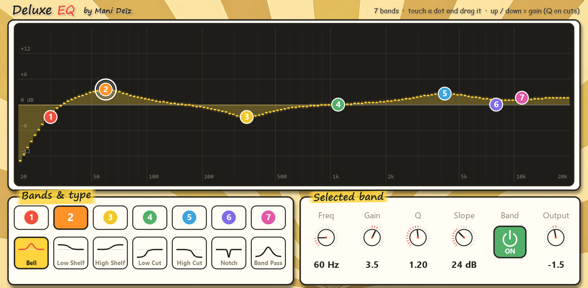
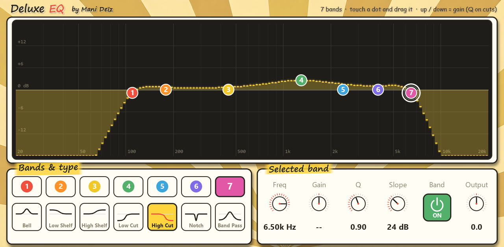

  

<h1 align="center">DELUXE EQ</h1>

  <b>A 7-band equalizer you play with your finger.</b> 
  Touch a dot on the curve and drag it. What you see is what you hear. 
  by <b>MANI DEÏZ</b>

  
  
  
  

  <a href="download/Deluxe-EQ.zip"><b>⬇&nbsp; DOWNLOAD</b></a>
  &nbsp;·&nbsp;
  <a href="#install">Install</a>
  &nbsp;·&nbsp;
  <a href="#how-to-use-it">How to use it</a>
  &nbsp;·&nbsp;
  <a href="#presets">Presets</a>

---

## What it does

An equalizer made for a touch screen, not ported from a mouse. Seven bands, each one a coloured dot sitting on the curve.

| | |
|---|---|
| **Touch and drag** | Grab a dot: left / right moves the frequency, up / down the gain. On cuts, notch and band-pass, up / down sets how sharp it is. |
| **The curve is the truth** | The line on the screen is the real response of the EQ, not a sketch of it. |
| **Seven filter types per band** | Bell, Low Shelf, High Shelf, Low Cut, High Cut, Notch, Band Pass. |
| **Steep cuts** | Low and high cuts at 12, 24, 36 or 48 dB per octave. |
| **No accidents** | Touching empty space does nothing. Only a dot moves. |
| **No clicks** | Moves glide, and changing a type or switching a band cross-fades. |

   
  Low cut and high cut at 24 dB per octave

## How to use it

- **The dots**: touch one and drag it. The ringed dot is the selected band.
- **Bands & type** (bottom left): buttons 1 to 7 select a band, the row under them picks its filter type.
- **Selected band** (bottom right): Freq, Gain, Q and Slope as knobs for fine moves, the band's ON switch, and Output.

## Presets

`Flat` · `Boom Bap Drums` · `Kick & Bass Weight` · `Clean Up Mud` · `Vocal Air` · `Dusty Sample` · `Telephone` · `Radio Band Pass`

## Install

1. Download **[Deluxe-EQ.zip](download/Deluxe-EQ.zip)** and unzip it.
2. Copy the folder found inside `VST2 Plugins` into the `VST2 Plugins` folder at the root of your SD card or USB drive
   (create that folder if it is not there). Do not rename it.
3. On the MPC: **Preferences → Enhancements (Beta)** (scroll the list on the left) → switch on *Enable Enhancements*
   and *External Plugin Support*.
4. Restart the MPC. Deluxe EQ is in the insert effects, under **MANI DEÏZ**.

No network, no account, nothing else to install. To remove it, delete its folder from `VST2 Plugins`.

## Which MPCs

Any standalone MPC running **MPC OS 3.10.1 or later** (older firmware cannot load third-party plugins).

| MPC | |
|---|---|
| **Live III** | ✅ made on it |
| XL | 🟡 same build, not tried yet |
| Live, Live II, One, One+, X, X SE, Key 37, Key 61, Force | 🟡 a 32-bit build is in the zip, not tried yet |

If you run it on one of the 🟡 machines, tell me how it goes.

## Found a bug?

Write to **[manideiz.plugins@proton.me](mailto:manideiz.plugins@proton.me)** with:

- your MPC model and its MPC OS version,
- what you did and what happened.

## Rights

Deluxe EQ is **free to use**. It is **© 2026 MANI DEÏZ, all rights reserved**: please link to this page rather than
re-uploading the zip, and do not sell it, modify it or reuse its code or graphics (see [LICENSE](LICENSE)).

Deluxe EQ is an independent plugin. It is not made, endorsed or supported by Akai Professional.
"MPC" and "Akai Professional" are trademarks of inMusic Brands, Inc.

MANI DEÏZ · beats, drums and tools

